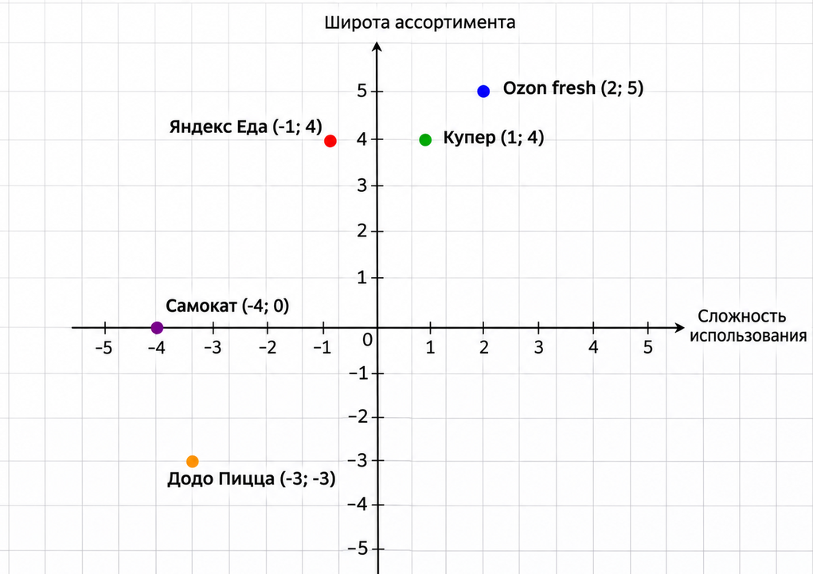

# Анализ конкурентов. Тема: сервисы доставки еды

## Пункты 1–2. Сервисы и их характеристики

### Яндекс Еда

#### Характеристика:

Один из крупнейших российских сервисов доставки готовой еды из ресторанов и кафе. Позволяет заказывать блюда различных кухонь мира, продукты из магазинов и товары повседневного спроса. Пользователи могут выбирать заведения по рейтингу, стоимости и времени доставки, отслеживать заказ на карте и пользоваться скидками. Сервис интегрирован в экосистему Яндекса.

#### Плюсы:

1. Большой выбор ресторанов и кафе;
2. Удобное приложение с понятным интерфейсом;
3. Отслеживание курьера в реальном времени;
4. Регулярные акции, промокоды и персональные предложения.

#### Минусы:

1. Стоимость доставки может увеличиваться в часы пик;
2. Цены на блюда иногда выше, чем непосредственно в ресторане;
3. Качество доставки зависит от конкретного заведения и курьера;
4. Не все рестораны доступны в небольших городах.

### Самокат

#### Характеристика:

Российский сервис экспресс-доставки продуктов, готовой еды и товаров повседневного спроса. Основная особенность — быстрая доставка от 15 минут благодаря сети локальных складов (дарксторов), расположенных рядом с жилыми районами. Самокат также предлагает товары собственных торговых марок и регулярно расширяет ассортимент продуктов.

#### Плюсы:

1. Высокая скорость доставки;
2. Удобный и минималистичный интерфейс;
3. Наличие товаров собственного бренда;
4. Большой выбор продуктов для повседневных покупок.

#### Минусы:

1. Ограниченный ассортимент по сравнению с крупными супермаркетами;
2. Доставка доступна не по всем адресам;
3. Некоторые товары могут стоить дороже, чем в обычных магазинах;
4. Возможны задержки при высокой загруженности курьеров.

### Ozon fresh

#### Характеристика:

Сервис быстрой доставки продуктов питания и товаров повседневного спроса от маркетплейса Ozon. Предлагает свежие продукты, готовую еду, напитки, бытовую химию, товары для детей и дома. Заказы оформляются через приложение или сайт Ozon. Сервис ориентирован на пользователей, которым необходимо быстро приобрести продукты и другие необходимые товары.

#### Плюсы:

1. Широкий ассортимент продуктов и бытовых товаров;
2. Интеграция с популярным маркетплейсом Ozon;
3. Удобный поиск товаров и оформление заказа;
4. Возможность совместить покупку продуктов и других необходимых товаров.

#### Минусы:

1. Ограниченная география экспресс-доставки;
2. Некоторые товары могут временно отсутствовать;
3. Доступность быстрой доставки зависит от адреса;
4. Интерфейс может быть перегружен дополнительными предложениями.

### Додо Пицца

#### Характеристика:

Крупная сеть пиццерий, основанная в 2011 году в Сыктывкаре. Специализируется на приготовлении и доставке пиццы, закусок, десертов и напитков. Имеет собственное мобильное приложение и сайт для оформления заказов. Использует информационную систему Dodo IS для автоматизации процессов приготовления, обработки заказов и управления доставкой. Предлагает программу лояльности, акции и возможность отслеживания заказа.

#### Плюсы:

1. Удобное приложение и простой процесс оформления заказа;
2. Собственная система доставки и контроля качества;
3. Программа лояльности, бонусы и регулярные акции;
4. Возможность отслеживания статуса приготовления и доставки заказа.

#### Минусы:

1. Ограниченный ассортимент по сравнению с универсальными сервисами;
2. Стоимость некоторых блюд выше, чем у небольших местных пиццерий;
3. В часы пик возможны задержки доставки;
4. Доставка доступна только в зоне обслуживания пиццерий.

### Купер

#### Характеристика:

Российский сервис доставки продуктов, готовой еды и товаров из магазинов, ранее известный как СберМаркет. Сотрудничает с крупными супермаркетами, ресторанами и другими торговыми организациями. Позволяет оформить крупную продуктовую корзину, выбрать удобное время доставки или заказать товары с экспресс-доставкой. Пользователи могут выбирать товары из разных категорий и отслеживать выполнение заказа.

#### Плюсы:

1. Большой выбор магазинов и супермаркетов;
2. Удобен для крупных продуктовых закупок;
3. Возможность выбора времени доставки;
4. Доставка продуктов и готовых блюд в одном сервисе.

#### Минусы:

1. Стоимость доставки зависит от условий заказа;
2. Возможны замены отсутствующих товаров;
3. Сборка крупных заказов требует дополнительного времени;
4. Качество комплектации зависит от магазина и сборщика.

## 3. Оценка удобства использования

**Таблица 1. Оценка удобства использования**

| Сервис | Что понравилось | В чём неудобство |
|---|---|---|
| Яндекс Еда | Удобный интерфейс, большой выбор ресторанов, отслеживание заказа | Дополнительные сборы, высокая стоимость доставки в часы пик |
| Самокат | Быстрая доставка, простой интерфейс, удобный каталог | Ограниченный ассортимент и зона доставки |
| Ozon fresh | Большой выбор продуктов, интеграция с Ozon, удобный поиск | Перегруженность интерфейса, ограниченная география |
| Додо Пицца | Удобное приложение, отслеживание заказа, программа лояльности | Ограниченный ассортимент, задержки в часы пик |
| Купер | Удобен для крупных покупок, большой выбор магазинов | Возможные замены товаров, более долгая сборка заказа |

## 4. Целевая аудитория

**Таблица 2. ЦА**

| Сервис | Целевая аудитория |
|---|---|
| Яндекс Еда | Студенты, офисные сотрудники, занятые люди 18–45 лет, регулярно заказывающие готовую еду |
| Самокат | Молодёжь 18–35 лет, студенты, молодые семьи, которым важна скорость доставки |
| Ozon fresh | Семьи и работающие люди 25–50 лет, регулярно покупающие продукты и бытовые товары |
| Додо Пицца | Молодёжь 16–35 лет, студенты, семьи с детьми, компании друзей и любители пиццы |
| Купер | Семьи 25–55 лет, занятые люди и покупатели, совершающие крупные продуктовые закупки |

## 5. Цели и задачи сервисов

**Таблица 3. Цели и задачи сервисов**

| Сервис | Цель | Задачи |
|---|---|---|
| Яндекс Еда | Удерживать лидирующие позиции на рынке доставки еды | Расширять количество ресторанов; сокращать время доставки; повышать лояльность пользователей |
| Самокат | Обеспечивать максимально быструю доставку продуктов | Развивать сеть дарксторов; оптимизировать логистику; расширять ассортимент |
| Ozon fresh | Развивать экспресс-доставку продуктов внутри экосистемы Ozon | Расширять географию; увеличивать ассортимент; совершенствовать систему доставки |
| Додо Пицца | Развивать сеть пиццерий и повышать качество доставки | Открывать новые заведения; совершенствовать приложение; расширять меню; удерживать постоянных клиентов |
| Купер | Стать универсальным сервисом доставки из магазинов и ресторанов | Подключать новых партнёров; улучшать качество сборки; сокращать сроки доставки |

## 6. Матрица позиционирования

**Ось X:** сложность использования сервиса (от низкой к высокой).

**Ось Y:** широта ассортимента и функциональных возможностей (от низкой к высокой).

Для построения матрицы используется условная шкала от −5 до +5.

**Таблица 4. Координаты сервисов**

| Сервис | Ось X | Ось Y |
|---|---:|---:|
| Яндекс Еда | -1 | 4 |
| Самокат | -4 | 0 |
| Ozon fresh | 2 | 5 |
| Додо Пицца | -3 | -3 |
| Купер | 1 | 4 |

### Матрица позиционирования

**Рисунок 1. Матрица позиционирования**

На матрице видно, что Самокат и Додо Пицца имеют низкий порог входа благодаря простому процессу заказа. При этом Додо Пицца обладает более узким ассортиментом, поскольку специализируется на пицце и сопутствующих блюдах. Ozon fresh и Купер предлагают наиболее широкий выбор товаров, а Яндекс Еда сочетает удобство использования с большим количеством ресторанов.

## 7. SWOT-анализ

SWOT-анализ проводится для нового сервиса доставки еды, планирующего выйти на российский рынок.

### Сильные стороны:

1. Простой и понятный интерфейс приложения;
2. Возможность сотрудничества с местными ресторанами;
3. Гибкая система скидок и бонусов;
4. Индивидуальный подход к клиентам;
5. Возможность быстрой адаптации к пожеланиям пользователей.

### Слабые стороны:

1. Отсутствие узнаваемости бренда;
2. Ограниченный бюджет на рекламу;
3. Небольшое количество ресторанов-партнёров на старте;
4. Недостаточное количество курьеров;
5. Отсутствие постоянной клиентской базы.

### Возможности:

1. Развитие рынка онлайн-доставки продуктов и готовой еды;
2. Привлечение местных ресторанов и кафе;
3. Использование социальных сетей для продвижения;
4. Внедрение программы лояльности;
5. Расширение географии доставки;
6. Сотрудничество с блогерами для рекламы.

### Угрозы:

1. Высокая конкуренция со стороны Яндекс Еды, Самоката и других крупных сервисов;
2. Рост расходов на логистику и оплату труда курьеров;
3. Повышение стоимости продуктов и готовых блюд;
4. Изменение законодательства в сфере доставки;
5. Снижение покупательной способности населения;
6. Технические сбои приложения и проблемы с доставкой.

### SWOT-матрица

**Таблица 5. SWOT-матрица**

| | Возможности | Угрозы |
|---|---|---|
| **Сильные стороны** | Использовать простой интерфейс, индивидуальный подход и сотрудничество с местными ресторанами для привлечения клиентов; развивать бонусную систему и продвигаться через социальные сети; проводить специальные акции. | Конкурировать с крупными сервисами за счёт персонализированного обслуживания, выгодных предложений и качественной поддержки пользователей; обеспечивать стабильную работу приложения. |
| **Слабые стороны** | Компенсировать небольшой рекламный бюджет продвижением через социальные сети, локальных блогеров и партнёрские акции; постепенно расширять количество ресторанов и курьеров; привлекать новых клиентов бонусами. | Начать работу в одном городе или районе, контролировать расходы, минимизировать технические риски; обеспечить стабильную работу доставки и постепенно формировать постоянную клиентскую базу. |

